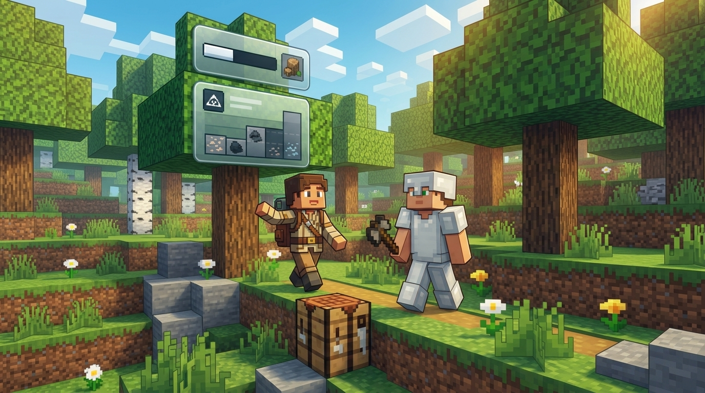
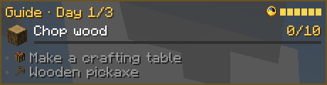
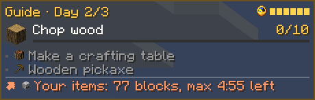
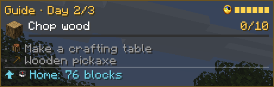
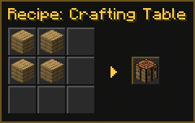
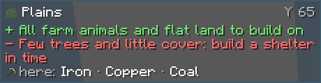

<p align="center"></p>

#  Survival Assistant

A Fabric mod for **Minecraft 26.3** that helps new players get through their first days in survival.
A friendly guide walks with you and tells you what to do next. A compact task card shows your progress,
and an environment card explains your current biome and which ores are worth digging for at your height.

All advice follows a researched beginner path. Recipes, mob spawns, ore heights and other facts were
**checked against the game's own data files** ([research](docs/research-first-days.md),
[biome and ore facts](docs/biomes-and-heights.md)). There are no speedrun tricks: it's aimed at an average player.

## Features

### The guide
- A guide character spawns next to you in a new world. It follows you, can't be hurt, and monsters ignore it.
- It gives tips in chat at the right moment, praises you when you reach a goal, and looks at the nearest tree
  or stone when it tells you to gather them.
- Right-click the guide for a tip and your progress.
- After 3 in-game days it asks whether you still need it. Click **[Yes, 3 more days]** to keep it around
  (you can extend as often as you like), or **[No, thanks]** to say goodbye. No answer within a day means goodbye.
- Reach all 15 goals and the guide congratulates you (title, sound and a burst of particles) and offers
  **chapter 2**. Say no and it leaves: you're ready. You can always call it back with `/guide call`.

### Chapter 2: settling in
Ten more goals for after the first days, in 4 in-game days (extendable):
start a farm, bake bread, breed animals, full iron armor, bow and 16 arrows, find diamonds, a diamond
pickaxe, 10 obsidian, flint and steel, and an enchanting table. It prepares you for the Nether without
sending you there. The research and checked game facts are in
[docs/research-chapter-2.md](docs/research-chapter-2.md). Finish it for one more celebration.
- Don't want a character walking around? `/guide character off` removes it. The task card stays, and you
  only get urgent warnings in chat.

### Your own guide skin
- Put any Minecraft skin (PNG, 64x64) in `config/survivalassistant/skins/`, then use `/guideskin reload`
  and `/guideskin set <name>` (the file name without `.png`, with tab completion). `/guideskin set default`
  brings back the built-in guide.
- File names ending in `_slim` (for example `elf_slim.png`) use the slim (Alex) arms. The skin's second
  layer (hat, jacket, sleeves, pants) is shown too.
- `/guideskin list` shows the skins (click one to use it) and `/guideskin folder` gives a clickable link to
  the folder. This is client-side: only you see your choice, on any server.

### Task card (top-left by default)
<p>
  
  
</p>

- 15 goals in order: wood → crafting table → wooden pickaxe → stone tools → furnace → food → bed →
  torches → shelter → chest → iron → shield → iron pickaxe → iron armor → bucket of water.
- Live counters (for example logs 6/10 or wool 2/3), with a check-mark animation when a goal is done.
- A clock (the in-game clock item) with a bar that counts down to sunset, turning orange at dusk and red at night.
- **Urgent mode**: the border pulses red, and the current-task line becomes a warning (creeper nearby,
  low health, hunger, dusk or night outside, thunderstorm, underground without torches).
- Press **J** to switch between compact, the full list of all 15 goals, and hidden.

### Safety and finding your way
<p>
  
  
</p>

- **Back to your items**: after you die, the bottom of the task card shows a rotating arrow, the distance to
  where you died and how long your items stay (max 5:00). It disappears once you've been there.
- **Way home**: when you're more than 64 blocks from your bed (or first workstation), or it gets dark and
  you're more than 24 blocks away, an arrow points you home.
- **Mining safety**: a warning when you dig the block under your own feet twice in a row (digging straight
  down), when lava is within a few blocks underground, or when sand/gravel hangs right above your head.
- **Phantoms**: a reminder after two nights without sleep (phantoms come after three).

### Learning as you play


- **Recipe card**: open your inventory or a crafting table and a small card next to the window shows how to
  craft the item for your current task (grid, arrow, result). For 3x3 recipes in the inventory it reminds
  you that you need a crafting table. The full list (J) shows the same recipe under the goals.
  All 18 recipes are checked against the game data (`tools/recipe_check.py`).
- **Crosshair info**: look at a mob for a moment and a line under the crosshair tells you what it does
  (creeper, skeleton, enderman, the new parched skeleton, sheep, ...). Look at an ore and it tells you which
  pickaxe you need: green when your tool works, red when it would break the block without dropping anything.

### Light check (key L)
- Press **L** and small red dots appear on every nearby spot where a monster could spawn (dark floor with
  room for a 2-block-tall mob, block light 0). Place torches until the dots are gone; when everything around
  you is lit, the action bar tells you so. Press L again to turn it off.
- Scans 16 blocks around you every half second, client-side only. Outdoors the dots show where monsters
  can spawn at night. In the Nether light doesn't stop spawns, and the check says so.

### Environment card (below the task card)


- A pro and a con for all 67 biomes (grouped into 25 families).
- Ores at your current Y-level, most valuable first (gold = you are at its best height). Emerald only shows in mountain biomes, and the extra
  surface gold only in badlands.
- A pointer to the best height for the ore your current task needs.
- One-time chat notes the first time you reach deepslate, the lava level, the deep dark or high mountains.
- Press **K** to show or hide it.

### Small talk with a local AI model (optional)
- With a local language model running, the guide chats: it remarks on what changes around you (rain or a
  thunderstorm, sunrise and nightfall, entering a cave, a new biome, a mob it hasn't talked about yet) and answers
  when you talk to it in normal chat.
- Alone near the guide, everything you say is meant for it. With other players nearby, mention the guide by name.
- It speaks your game language, gets the checked biome facts from the language files and knows your current goal.
  It does **not** give recipes, ore heights or instructions: a small model gets those wrong, so they stay with the
  tips and the task card. It is quiet while a warning is active or the guide is muted, and waits at least 2 minutes
  between spontaneous remarks.
- Runs fully local with [llama.cpp](https://github.com/ggml-org/llama.cpp): start `llama-server` with a small
  instruct model before you play. Without a server the guide simply stays quiet; nothing else changes.
- Off by default. Turn it on for yourself with `/guide chat on` (and off again with `/guide chat off`), or for
  everyone on the server with `chatEnabled` in the config.

#### Which model?
The model shares your computer with Minecraft, which needs 2 GB VRAM at minimum and 6 GB recommended (26.x).
The replies are short (at most 80 tokens), so a small model is enough, and it may even run on the CPU.

| Your graphics card | Model (GGUF, Q4_K_M) | Run it on | Model size |
|---|---|---|---|
| 12 GB VRAM or more | **Gemma 4 E4B** (most creative small model) | GPU: `-ngl 99` | about 5 GB |
| 8 GB VRAM | **Qwen3.5 4B** (or Gemma 4 E2B) | GPU: `-ngl 99` | about 3 GB |
| 6 GB VRAM or less, or integrated graphics | **Qwen3.5 4B** | CPU: `-ngl 0` (needs 16 GB+ RAM) | about 3 GB of RAM |
| an older or slow CPU on top of that | Qwen3.5 2B | GPU or CPU | about 1.5 GB |

```
llama-server -m gemma-4-E4B-it-Q4_K_M.gguf -ngl 99 -c 4096 --port 8080
llama-server -m Qwen3.5-4B-Q4_K_M.gguf -ngl 0 -c 2048 --port 8080   # CPU only, VRAM stays free
```
- Use the normal instruct model, not a "reasoning"/"thinking" variant, and skip the `mmproj` (vision) file.
  The mod already switches thinking off with every request.
- If the game stutters, lower `-ngl` or `-c`; if replies arrive too late on the CPU, raise `chatTimeoutSeconds`.
  `chatTemperature` sets the mood (0.6 calm, 1.0 playful).
- No published benchmark covers the Dutch of these small models yet, so try both Gemma 4 and Qwen3.5 and keep
  the one you like. Sizes, alternatives (Phi-4-mini, Ministral 3, Llama 3.2) and sources are in
  [docs/research-chat-models.md](docs/research-chat-models.md).

## Commands

| Command | What it does |
|---|---|
| `/guide tip` | Get the most important tip right now |
| `/guide call` | Bring the guide to you (or back after it said goodbye) |
| `/guide dismiss` | Send the guide away |
| `/guide chat on\|off` | Small talk with the guide through a local language model (saved per player) |
| `/guide extend` | Let the guide stay 3 more days |
| `/guide continue` | Start chapter 2 (after all 15 chapter-1 goals) |
| `/guide mute <minutes>` | No unsolicited tips for a while (0–120) |
| `/guide character on\|off` | Show or hide the guide character (saved per player) |
| `/guideskin list\|set <name>\|reload\|folder` | Choose your own guide skin (client-side) |

## Configuration

**Server**: `config/survivalassistant.json`

| Option | Default | Meaning |
|---|---|---|
| `maxDays` | `3` | In-game days the guide stays |
| `chapter2` | `true` | Offer chapter 2 after the first 15 goals |
| `chapter2Days` | `4` | In-game days the guide stays for chapter 2 |
| `extendDays` | `3` | Days added when the player says they still need the guide (`0` = never ask, just leave) |
| `tipIntervalSeconds` | `2` | How often the situation is checked |
| `milestoneCooldownSeconds` | `180` | Minimum time between repeats of the same task tip |
| `urgentCooldownSeconds` | `60` | Minimum time between repeats of the same warning |
| `allowRecall` | `true` | Allow `/guide call` after the guide has left |
| `npcEnabledByDefault` | `true` | Default for the guide character (players can override) |
| `depthNotices` | `true` | One-time chat notes about depth and mountains |
| `spawnOnJoin` | `true` | Give new players a guide automatically |
| `pointAtResources` | `true` | Guide looks at nearby trees/stone when giving those tips |
| `navigation` | `true` | Show the way back to your items after dying, and the way home |
| `homeDistance` | `64` | Show the way home from this distance (24 at dusk/night) |
| `chatEnabled` | `false` | Small talk through a local language model (default; players can use `/guide chat on\|off`) |
| `chatEndpoint` | `http://127.0.0.1:8080/v1/chat/completions` | OpenAI-compatible endpoint (llama-server's default) |
| `chatModel` | `local` | Model name sent along (llama-server ignores it) |
| `chatSpontaneous` | `true` | Remark on changes in the surroundings without being asked |
| `chatCooldownSeconds` | `120` | Minimum time between spontaneous remarks |
| `chatHearingDistance` | `16` | The guide reacts to chat within this distance |
| `chatSightRadius` | `16` | Mobs within this distance (and in sight) count as nearby |
| `chatMaxTokens` | `80` | Maximum reply length |
| `chatTemperature` | `0.8` | Higher is more playful |
| `chatTimeoutSeconds` | `20` | Give up on an answer after this long |
| `chatHistoryTurns` | `6` | Exchanges the guide remembers within a session |

**Client**: `config/survivalassistant-client.json`

| Option | Default | Meaning |
|---|---|---|
| `corner` | `TOP_LEFT` | `TOP_LEFT`, `TOP_RIGHT`, `BOTTOM_LEFT` or `BOTTOM_RIGHT` |
| `mode` | `COMPACT` | Task card mode: `COMPACT`, `FULL` or `HIDDEN` (J) |
| `showEnvironment` | `true` | Show the environment card (K) |
| `envLines` | `FULL` | `COMPACT` shows only the biome header and ore line |
| `recipeCard` | `true` | Recipe card next to the inventory / crafting table |
| `crosshairInfo` | `true` | Tip under the crosshair for mobs and ores |
| `guideSkin` | `default` | Guide skin from `config/survivalassistant/skins` (set with `/guideskin set`) |
| `scale` | `1.0` | Extra scale on top of the GUI scale (0.5–2.0) |
| `margin` | `4` | Distance from the screen edge |

## Languages
15 languages; the game language decides which one is used:

| | | |
|---|---|---|
| English (`en_us`) | Mandarin Chinese, simplified (`zh_cn`) | Hindi (`hi_in`) |
| Spanish (`es_es`) | Arabic (`ar_sa`) | French (`fr_fr`) |
| Portuguese, Brazil (`pt_br`) | Russian (`ru_ru`) | Indonesian (`id_id`) |
| Dutch (`nl_nl`) | German (`de_de`) | Italian (`it_it`) |
| Polish (`pl_pl`) | Ukrainian (`uk_ua`) | Romanian (`ro_ro`) |

- The list: the most spoken languages worldwide (Ethnologue 2025) plus the most spoken European ones. Bengali is
  in the world top 10 but Minecraft has no Bengali language option, so Indonesian (number 10) takes its place.
- Regional variants with the same script get a copy: Spanish (Mexico, Argentina, Chile, Ecuador, Uruguay,
  Venezuela), French (Canada, Switzerland), Portuguese (Portugal), German (Austria, Switzerland) and Dutch
  (Belgium). Traditional Chinese falls back to English.
- English and Dutch are the original texts; the other 13 languages are AI translations that use Minecraft's
  own names for items and mobs where possible and have not yet been checked by native speakers. Corrections are very welcome as an issue or pull
  request: the texts live in `tools/lang/<code>.json` and `tools/make_lang.py` checks every key and placeholder.
- Minecraft draws Arabic right-to-left with joined letters itself. Hindi looks like Minecraft's own Hindi: the
  game font does not join Devanagari letter combinations.

## Requirements and installation
- Minecraft **26.3**
- [Fabric Loader](https://fabricmc.net/) **0.20.1** or newer
- [Fabric API](https://modrinth.com/mod/fabric-api)
- Java **25**

Put the mod jar and Fabric API in your `mods` folder. The mod is needed on the server (or in singleplayer)
for the guide and advice, and on the client for the cards.

## Building from source
```sh
./gradlew build                 # builds the jar and runs the unit tests
./gradlew runClient             # starts a development client
./gradlew installToModrinth     # copies the jar into a Modrinth App instance ("Mod Testing" by default)
./gradlew installToModrinth -PmodrinthInstance="My Instance"
```
Build output goes to `%LOCALAPPDATA%/gradle-builds/survivalassistant` when that variable exists (Windows),
because sync tools like OneDrive lock files in `build/`. On other systems it uses the normal `build/` folder.
After every build the mod jar and sources jar are also copied to the project folder itself (git-ignored).

Developer tools:
- `tools/make_lang.py` generates all language files (English and Dutch from its own table, the others from
  `tools/lang/<code>.json`) and checks that every language has the same keys and placeholders.
- `tools/biome_facts.py` regenerates [docs/biomes-and-heights.md](docs/biomes-and-heights.md) from the Minecraft jar.
- `tools/make_icon.py` builds the transparent PNG icons from `docs/images/SurvivalAssistant.jpg`
  (`uv run --with pillow python tools/make_icon.py`).

## How the advice was verified
See [docs/research-first-days.md](docs/research-first-days.md) for the sources, the consensus and a table of
claims checked against recipes, loot tables and game code. See [docs/biomes-and-heights.md](docs/biomes-and-heights.md)
for ore placement and mob spawns per biome, extracted from the 26.3 data. The pure advice logic
(`advice` package) has no Minecraft dependencies and is covered by unit tests.

## License
[MIT](LICENSE) © 2026 David Visser
