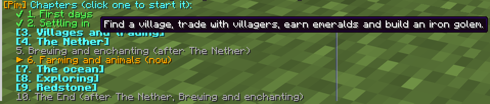
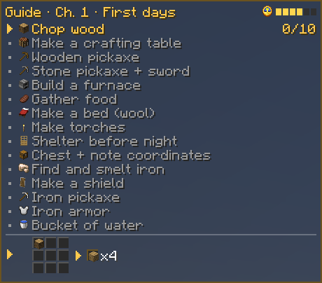
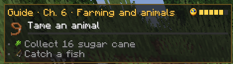

#  Survival Assistant

A Fabric mod for **Minecraft 26.3** that teaches survival, from your very first night to the ender dragon and
beyond. A friendly guide called Pim walks with you through **18 chapters**: he tells you what to do next, warns you
when you're in danger and celebrates every goal you reach. A compact task card shows your progress, and an
environment card explains your current biome and which ores are worth digging for at your height.

All advice follows a researched path for an average player, without speedrun tricks. Recipes, mob spawns, ore
heights and other facts were **checked against the game's own data files**; see
[How the advice was verified](#how-the-advice-was-verified).

## Features

### The guide
- A guide character spawns next to you in a new world. It follows you, can't be hurt, and monsters ignore it.
- It gives tips in chat at the right moment, praises you when you reach a goal, and looks at the nearest tree
  or stone when it tells you to gather them.
- Sneak and right-click the guide for a tip and your progress in the current chapter.
- It never gets in your way: it doesn't push you, keeps out of your view and your path, and normal clicks,
  hits, arrows and blocks you place go straight through it. It doesn't set off pressure plates, tripwires or
  sculk sensors, doesn't trample farmland and doesn't follow you into boats, minecarts or portals. When you
  change dimension it simply appears next to you again.
- No chapter has a time limit, the first days included: the guide stays as long as you're working on a chapter.
  Take your time.
- Finish a chapter and the guide congratulates you (title, sound and a burst of particles) and shows the
  chapter menu. Rather go on alone? Click **[I'll manage]**. You can always call it back with `/guide call`.
- Don't want a character walking around? `/guide character off` removes it. The task card stays, and you only
  get urgent warnings in chat.

### Meet Pim
- The guide has a name and a past: **Pim**, an old explorer who has travelled through more worlds than he can count.
  His own first night went badly (lost, in a hole in the ground with a single torch), and that is why he now helps
  newcomers. He collects maps and keeps losing them, never finished his own house, loves sunrises, foxes and fresh
  bread, and is still afraid of creepers.
- He introduces himself when you meet. Use `/guide about` to hear a little more about him (a different story every
  time), and now and then he tells one by himself when there is nothing left to say about the place you're in.
- With small talk on you can simply ask him: "Pim, where are you from?" The model answers from the same
  background, so his story stays consistent.
- Prefer another name? `/guide name <name>` (up to 16 letters, digits, spaces, `-` or `_`; `/guide name reset` goes back).
  Server owners can change the default with `guideName` in the config.

### Chapters: a Minecraft tutorial
Chapters 1 and 2 are the base; after that you pick what you want to learn from a menu in chat
(`/guide chapters`). Some chapters need others first.

| # | Chapter | Opens after | Goals |
|---|---|---|---|
| 1 | **First days** | – | Wood, tools, a shelter, food, torches, iron, a shield (15 goals) |
| 2 | **Settling in** | 1 | A farm, bread, breeding, full iron armor, a bow, diamonds, obsidian, an enchanting table |
| 3 | **Villages and trading** | 2 | Find a village, trade (5 times), 10 emeralds, an enchanted book from a librarian, an iron golem |
| 4 | **The Nether** | 2 | Golden armor for the piglins, enter the Nether, find a fortress, blaze rods, Nether wart, back home safely |
| 5 | **Brewing and enchanting** | 4 | A brewing stand, your first potion, 15 bookshelves, level 30, enchanting, an anvil |
| 6 | **Farming and animals** | 2 | Tame an animal, milk, 16 sugar cane, catch a fish, honey (safely), ride your own horse |
| 7 | **The ocean** | 2 | A boat, a shipwreck or ocean ruin, buried treasure, a turtle shell, a trident |
| 8 | **Exploring** | 2 | A map, a spyglass, a desert or jungle temple, the trial chambers, open a vault |
| 9 | **Redstone** | 2 | 16 redstone, an automatic iron door, a powered piston, a repeater, a hopper |
| 10 | **The End** | 4 and 5 | 12 ender pearls, 12 eyes of ender, the stronghold, enter the End, defeat the dragon, an end city, an elytra |
| 11 | **Netherite and bastions** | 4 | Ancient debris, a netherite ingot, a bastion, the upgrade template, netherite gear, a respawn anchor |
| 12 | **The Wither and the beacon** | 4 and 5 | 3 wither skeleton skulls, 4 soul sand, summon and defeat the Wither, a beacon, a full beacon |
| 13 | **The Deep Dark** | 8 | An ancient city, sneak past sculk, 8 echo shards, a recovery compass |
| 14 | **Raids and Illagers** | 3 | A pillager outpost, a raid captain, an ominous bottle, win a raid, a totem of undying |
| 15 | **Archaeology and trims** | 8 | A brush, trail ruins, a pottery sherd, a decorated pot, an armor trim, a sniffer egg |
| 16 | **Trial challenges** | 8 | 2 breeze rods, wind charges, an ominous vault, the heavy core, the mace |
| 17 | **The happy ghast** | 4 | A dried ghast, put it in water, a ghastling, a harness, fly on a happy ghast |
| 18 | **Automation** | 9 and 4 | An observer, an automatic furnace, a lit copper bulb, a crafter, a crafter that crafts a crafter |

Chapters 1-10 take you from your first night to the ender dragon, 11-14 are the endgame, and 15-18 cover
archaeology, the trial challenges, the happy ghast and automation.

- The menu shows finished chapters in green, the current one in gold, the ones you can start as buttons and
  locked ones in grey with what they need. Hover over a button to see what the chapter is about; click it to start.

<p>
  
</p>
<p>
  
</p>

- Switch any time with `/guide chapter <name>` (`village`, `nether`, `magic`, `husbandry`, `ocean`, `explorer`,
  `redstone`, `end`, `netherite`, `wither`, `deep_dark`, `raids`, `archaeology`, `trials`, `happy_ghast`,
  `automation`); progress is kept.
- Goals like "find a fortress" or "brew a potion" use Minecraft's own advancements, so they're detected exactly
  the way the game counts them. If you already did something, it's ticked off right away, and items you use up
  (skulls for the Wither, the heavy core in the mace) keep their goal ticked off.
- Finished everything with an older version? `/guide call` brings the guide back with the new chapters.

### Task card (top-left by default)
<p>
  
  
</p>
<p>
  
</p>

- The current task and the next two, with live counters (for example logs 6/10 or blaze rods 2/3) and a
  check-mark animation when a goal is done.
- **Steps**: big goals are split into small steps, shown under the current task with their own counter, and the
  guide tells you each step as soon as you reach it. Brewing a potion, for example, goes: glass bottles (3/3), fill
  them with water, blaze powder as fuel, brew. Steps exist for the first iron armor (8 iron, the chestplate, put it on), full iron armor (one step per missing piece, with its iron), the diamond pickaxe (an iron
  pickaxe, dig deep, 3 diamonds, craft), enchanting (a table, lapis, levels), the first farm (a hoe, seeds, tilled soil
  by water, plant), bread (ripe wheat, 9 wheat, bake),
  taming an animal (a wolf or cat, bones or raw fish, feed it), milk (iron, a bucket, a cow), fishing (string, a rod,
  water, cast), the bow (string, the bow, flint,
  feathers, arrows), the enchanting table, the iron golem, the Nether
  portal, the Nether fortress (the guide notices when one is close), blaze rods, Nether wart, brewing, bookshelves, honey (bottle, nest, campfire, wait), your own horse (find, tame, saddle),
  buried treasure (map, red X, dig), the turtle shell (turtles, seagrass, eggs, 5 scutes), the trident (find drowned, one holding a trident, beat it at the shore),
  eyes of ender, finding the stronghold, the
  dragon, the end city (the dragon, the gateway to the outer islands, a city nearby, walk in), the elytra (back to the End, an end city, its ship, the item frame), the netherite ingot, netherite gear
  (template, diamond gear, ingot, smithing table, upgrade), winning a raid (the ominous bottle, drink it, a village,
  every wave), the upgrade template (find a bastion, search its chests), the respawn anchor (crying obsidian, glowstone, craft, place in the Nether, charge 4/4),
  summoning the Wither (a safe spot, the T of soul sand, the skulls), the nether star (find the Wither, defeat it,
  pick up the star), the ominous bottle (an outpost, its captain, the bottle), the recovery compass (echo shards, a compass,
  craft), the mace (breeze rod, heavy core, craft), the piston (redstone, craft, place, power), sneaking past a sculk sensor (the deep dark, a
  sensor, sneak), opening a vault (the trial chambers, a trial key) and an ominous vault
  (an ominous bottle, drink it, the chambers, an ominous key), the beacon (and its full pyramid), the dried ghast (8 ghast tears around soul sand), putting it in water, letting it swell (0/3), the happy ghast's
  harness and riding it (a grown ghast, a harness, put it on, climb on), the automatic furnace and the
  decorated pot (4 sherds or bricks, craft), the armor trim (template, material, armor piece, smithing table,
  trim), the sniffer egg (a brush, a warm ocean ruin, brush the sand), the
  copper bulb (copper blocks, blaze rod, redstone, craft, place, a pulse) and a crafter that crafts a crafter (place
  one, the materials, fill it, a pulse). The recipe card follows the step (for example glass bottles, then blaze powder).
- The title shows the chapter you are in (for example Ch. 6 · Farming and animals).
- A clock (the in-game clock item) with a bar that counts down to sunset, turning orange at dusk and red at night.
- **Urgent mode**: the border pulses red, and the current-task line becomes a warning (a warden or creeper
  nearby, low health, hunger, dusk or night outside, a ghast, piglins without gold, a thunderstorm,
  underground without torches, ...).
- Press **J** to switch between compact, the full list of the chapter's goals, and hidden.

### Safety and finding your way
<p>
  
  
</p>

- **Back to your items**: after you die, the bottom of the task card shows a rotating arrow, the distance to
  where you died and how long your items stay (max 5:00). It disappears once you've been there.
- **Way home**: when you're more than 64 blocks from your bed (or first workstation), or it gets dark and
  you're more than 24 blocks away, an arrow points you home.
- **Mining safety**: a warning when you dig the block under your own feet twice in a row (digging straight
  down), when lava is within a few blocks underground, or when sand/gravel hangs right above your head.
- **Phantoms**: a reminder after two nights without sleep (phantoms come after three).
- **Safe in the light**: monsters only spawn in the dark. In a well-lit cave, or on a well-lit spot outside at
  night, the dark warnings stay quiet; instead the task card shows a green "Well lit" line and the guide tells
  you once that you're safe here. Monsters that are already around still get their warning.
- **The Nether**: warnings for a ghast nearby and for piglins when you're not wearing gold. A **warden** nearby
  is the most urgent warning of all: don't fight, sneak away. Overworld warnings (night, thunder, phantoms)
  stay quiet in the Nether and the End.
- **Place notes**, once each: the first time in the Nether (beds explode, piglins and gold, fast lava), a village
  and its first night, a desert temple (the TNT trap), a jungle temple (tripwires), the trial chambers, a
  shipwreck or ocean ruin (drowned, your air), a stronghold (silverfish), the End (endermen, the crystals, the
  void), an end city (shulkers), a bastion (brutes), an ancient city, a pillager outpost (Bad Omen), trail ruins
  (brush, don't mine) and your first wither skeleton skull (where never to summon the Wither).

### Learning as you play


- **Recipe card**: open your inventory or a crafting table and a small card next to the window shows how to
  craft the item for your current task (grid, arrow, result). For 3x3 recipes in the inventory it reminds
  you that you need a crafting table. The full list (J) shows the same recipe under the goals.
  All 48 recipe cards are checked against the game data (`tools/recipe_check.py`).
- **Crosshair info**: look at a mob for a moment and a line under the crosshair tells you what it does
  (creeper, skeleton, enderman, the new parched skeleton, sheep, ...). Look at an ore and it tells you which
  pickaxe you need: green when your tool works, red when it would break the block without dropping anything.
  Mobs get their tip from up to 16 blocks away (3 to 32 in the settings; walls block the view), so you can read
  about a creeper before it hisses. In the settings you can move the info from the crosshair to a third card under
  the environment card, where it stays for 2 seconds after you look away.

### Light check (key L)
- Press **L** and small red dots appear on every nearby spot where a monster could spawn (dark floor with
  room for a 2-block-tall mob, block light 0). Place torches until the dots are gone; when everything around
  you is lit, the action bar tells you so. Press L again to turn it off.
- Scans 16 blocks around you every half second, client-side only. Outdoors the dots show where monsters
  can spawn at night. In the Nether light doesn't stop spawns, and the check says so.

### Environment card (below the task card)


- A pro and a con for all 67 biomes (grouped into 25 families).
- Ores at your current Y-level, most valuable first (gold = you are at its best height). Emerald only shows in
  mountain biomes, and the extra surface gold only in badlands.
- A pointer to the best height for the ore your current task needs.
- One-time chat notes the first time you reach deepslate, the lava level, the deep dark or high mountains.
- Press **K** to show or hide it.

### The guide's musings
- Walk into a new biome and the guide shares a building idea for it: a farm with a red barn on the plains,
  a log cabin with a smoking chimney in the taiga, a sandstone market in the desert, a treehouse village in the
  jungle. Every biome family has its own idea, a scene and a small story or question.
- Animals in sight get a remark of their own (sheep growing their wool back, a fox asleep, bees and a campfire, ...).
  The facts in these lines were checked against the game.
- Quiet by design: at most one musing every 5 minutes (a new biome's building idea comes sooner), only by day,
  outside or in friendly caves, never during a warning, while muted, or without the guide character.
- Works without any AI, in all 15 languages. With small talk on (allowed by the server and a local model running) the model
  puts the same ideas in its own words.
- The Nether, the End, the Deep Dark and unknown places stay quiet unless you choose `/guide musings all`
  (then only careful remarks, no building ideas there). `/guide musings off` turns them off.

### Your own guide skin
- Put any Minecraft skin (PNG, 64x64) in `config/survivalassistant/skins/`, then use `/guideskin reload`
  and `/guideskin set <name>` (the file name without `.png`, with tab completion). `/guideskin set default`
  brings back the built-in guide.
- File names ending in `_slim` (for example `elf_slim.png`) use the slim (Alex) arms. The skin's second
  layer (hat, jacket, sleeves, pants) is shown too.
- `/guideskin list` shows the skins (click one to use it) and `/guideskin folder` gives a clickable link to
  the folder. This is client-side: only you see your choice, on any server.

### Small talk with a local AI model (optional)
- With a local language model running, the guide chats: it remarks on what changes around you (rain or a
  thunderstorm, sunrise and nightfall, entering a cave, a new biome, a mob it hasn't talked about yet) and answers
  when you talk to it in normal chat.
- Alone near the guide, everything you say is meant for it. With other players nearby, mention the guide by name.
- It speaks your game language, gets the checked biome facts from the language files and knows your current goal.
  It does **not** give recipes, ore heights or instructions: a small model gets those wrong, so they stay with the
  tips and the task card. It is quiet while a warning is active or the guide is muted, and waits at least 2 minutes
  between spontaneous remarks.
- Runs fully local with [llama.cpp](https://github.com/ggml-org/llama.cpp): start `llama-server` with a small
  instruct model before you play. Without a server the guide stays quiet (it only says it can't talk right now when you call it by name, and the
  log gets one warning); nothing else changes.
- Off by default. The server decides: switch it on with `chatEnabled` in the config (or *Small talk allowed* in the
  settings screen, World tab). Then every player has it, and each player can switch it off for themselves with
  `/guide chat off` (and back on with `/guide chat on`).
- Where your words go: by default to `llama-server` on your own computer (`127.0.0.1`). On a server, the model
  server the server owner configured receives what you say to the guide.

#### Which model?
The model shares your computer with Minecraft, which needs 2 GB VRAM at minimum and 6 GB recommended (26.x).
The replies are short (at most 80 tokens), so a small model is enough, and it may even run on the CPU.

| Your graphics card | Model (GGUF, Q4_K_M) | Run it on | Model size |
|---|---|---|---|
| 12 GB VRAM or more | **Gemma 4 E4B** (most creative small model) | GPU: `-ngl 99` | about 5 GB |
| 8 GB VRAM | **Qwen3.5 4B** (or Gemma 4 E2B) | GPU: `-ngl 99` | about 3 GB |
| 6 GB VRAM or less, or integrated graphics | **Qwen3.5 4B** | CPU: `-ngl 0` (needs 16 GB+ RAM) | about 3 GB of RAM |
| an older or slow CPU on top of that | Qwen3.5 2B | GPU or CPU | about 1.5 GB |

- Use the normal instruct model, not a "reasoning"/"thinking" variant, and skip the `mmproj` (vision) file.
- If the game stutters, lower `-ngl` or `-c`; if replies arrive too late on the CPU, raise `chatTimeoutSeconds`.
- No published benchmark covers the Dutch of these small models yet, so try both Gemma 4 and Qwen3.5 and keep
  the one you like. Sizes, alternatives (Phi-4-mini, Ministral 3, Llama 3.2) and sources are in
  [docs/research-chat-models.md](docs/research-chat-models.md).

#### Installing it (Windows)
1. **Install llama.cpp** (the `llama-server` program):
   ```
   winget install ggml.llamacpp
   ```
   This build uses Vulkan, so it works on NVIDIA, AMD and Intel graphics. Check that it sees your card with
   `llama-server --list-devices` (for example `Vulkan0: NVIDIA GeForce RTX 5070`).
2. **Download a model** (one `.gguf` file) into a folder of your choice, for example `C:\Users\<you>\models`:
   - Gemma 4 E4B, 5.0 GB: [gemma-4-E4B-it-Q4_K_M.gguf](https://huggingface.co/unsloth/gemma-4-E4B-it-GGUF/resolve/main/gemma-4-E4B-it-Q4_K_M.gguf)
   - Qwen3.5 4B, 2.7 GB: [Qwen3.5-4B-Q4_K_M.gguf](https://huggingface.co/unsloth/Qwen3.5-4B-GGUF/resolve/main/Qwen3.5-4B-Q4_K_M.gguf)
3. **Create a start file** next to the model, for example `start-guide-gemma.bat`:
   ```bat
   @echo off
   cd /d "%~dp0"
   llama-server -m gemma-4-E4B-it-Q4_K_M.gguf --device Vulkan0 -ngl 99 -c 4096 --parallel 1 -fa off ^
     --port 8080 --host 127.0.0.1 --chat-template-kwargs "{\"enable_thinking\":false}" ^
     --temp 1.0 --top-p 0.95 --top-k 64 --dry-multiplier 0.8 --dry-base 1.75 --dry-allowed-length 2
   pause
   ```
   For Qwen3.5 4B use its own file name and `--temp 0.7 --top-p 0.8 --top-k 20 --presence-penalty 1.5`
   instead of the Gemma sampling settings.
4. **Play**: double-click the start file (keep its window open), start Minecraft, and switch on *Small talk allowed* in the settings
   screen (World tab, under Advanced), or set `chatEnabled` to `true` in `config/survivalassistant.json`.

What the settings do, and why:

| Setting | Why |
|---|---|
| `--device Vulkan0` | Use the graphics card, not a second (integrated) GPU. Pick the number `--list-devices` shows for your card. |
| `-ngl 99` | The whole model on the graphics card: replies in well under a second. |
| `-c 4096 --parallel 1` | One player needs one slot; 4096 tokens fit the guide's prompt and its remembered conversation. |
| `-fa off` | With Vulkan, flash attention for this model partly falls back to the CPU; off is just as fast here. |
| `enable_thinking false` | **No reasoning.** A reasoning model first writes a hidden plan, which takes seconds and adds nothing to a one-line remark. The mod also sends this with every request. |
| `--temp 1.0 --top-p 0.95 --top-k 64` | Google's recommended Gemma 4 sampling: playful but coherent. (Qwen: `0.7 / 0.8 / 20`.) |
| `--dry-*` (Gemma), `--presence-penalty 1.5` (Qwen) | Discourage repeating words and phrases from earlier replies, so the guide doesn't keep saying the same thing. |

Measured on an RTX 5070 (12 GB): Gemma 4 E4B used about 3.2 GB of VRAM and wrote 115–130 tokens per second,
so a reply arrives in about 0.3 s. Its Dutch was clearly better than Qwen3.5 4B's, which was a bit faster
(about 130 tokens per second, 3.0 GB) but made up words now and then. The mod adds its own guard against
repetition (the guide remembers its last replies and is told to vary its wording) and removes emoji, which
Minecraft's font can't show.

## Commands

| Command | What it does |
|---|---|
| `/guide tip` | Get the most important tip right now |
| `/guide chapters` | Show the chapters: done, open (click to start) and locked |
| `/guide chapter <name>` | Start or switch to a chapter that is open |
| `/guide continue` | Start the next open chapter after finishing one |
| `/guide call` | Bring the guide to you (or back after it said goodbye) |
| `/guide dismiss` | Send the guide away |
| `/guide mute <minutes>` | No unsolicited tips for a while (0–120) |
| `/guide about` | The guide tells something about himself |
| `/guide name <name>\|reset` | Give the guide your own name (saved per player) |
| `/guide musings on\|off\|all` | The guide's remarks about biomes and animals (`all` includes the Nether, End and Deep Dark) |
| `/guide chat on\|off` | Small talk with the guide through a local language model (saved per player) |
| `/guide character on\|off` | Show or hide the guide character (saved per player) |
| `/guideskin list\|set <name>\|reload\|folder` | Choose your own guide skin (client-side) |
| `/guidesettings` | Open the settings screen |

Keys: **J** task card mode, **K** environment card, **L** light check. The settings screen has a key too, unbound
by default (Options → Controls → Key Binds → Survival Assistant).

## Settings

All options can be changed in the game, in the settings screen. Open it with the **Configure** button in
[Mod Menu](https://modrinth.com/mod/modmenu) (optional), with `/guidesettings`, or with its key. It has three tabs:

- **Display**: the task card (mode, corner, size, steps), the environment card, the recipe card, mob and ore info (distance, crosshair or card), the
  guide's skin, and a button for the keys. Stored on your computer.
- **My guide**: the guide character, your own name for the guide, musings and small talk. Stored with your player
  on the server, so this works on multiplayer servers too.
- **World**: the server options below. Without a world open you edit your own config file; in a world only the host
  of a singleplayer world or an admin operator (level 3) can see and change them. The language model
  options are folded away under *Advanced*.

Every option has a short explanation when you hover over it. **Done** saves, **Cancel** (or Esc) discards your
changes, and **Defaults** resets the current tab.

## Configuration files

The settings screen writes these files; you can also edit them by hand (server owners usually do).

**Server**: `config/survivalassistant.json`

| Option | Default | Meaning |
|---|---|---|
| `moreChapters` | `true` | Offer the next chapters after chapter 1 (was `chapter2`, still read) |
| `tipIntervalSeconds` | `2` | How often the situation is checked |
| `milestoneCooldownSeconds` | `180` | Minimum time between repeats of the same task tip |
| `urgentCooldownSeconds` | `60` | Minimum time between repeats of the same warning |
| `allowRecall` | `true` | Allow `/guide call` after the guide has left |
| `npcEnabledByDefault` | `true` | Default for the guide character (players can override) |
| `spawnOnJoin` | `true` | Give new players a guide automatically |
| `guideName` | `Pim` | The guide's name (players can choose their own with `/guide name`) |
| `depthNotices` | `true` | One-time chat notes about depths, mountains and special places (the Nether, temples, ...) |
| `pointAtResources` | `true` | Guide looks at nearby trees/stone when giving those tips |
| `navigation` | `true` | Show the way back to your items after dying, and the way home |
| `homeDistance` | `64` | Show the way home from this distance (24 at dusk/night) |
| `musings` | `true` | Musings about biomes and animals (players can use `/guide musings`) |
| `museIntervalSeconds` | `300` | Minimum time between two musings |
| `musingsInDangerZones` | `false` | Also muse in the Nether, the End, the Deep Dark and unknown places |
| `chatEnabled` | `false` | Allow small talk through a language model on this server (players can switch it off with `/guide chat off`) |
| `chatEndpoint` | `http://127.0.0.1:8080/v1/chat/completions` | OpenAI-compatible endpoint (llama-server's default) |
| `chatModel` | `local` | Model name sent along (llama-server ignores it) |
| `chatSpontaneous` | `true` | Remark on changes in the surroundings without being asked |
| `chatCooldownSeconds` | `120` | Minimum time between spontaneous remarks |
| `chatHearingDistance` | `16` | The guide reacts to chat within this distance |
| `chatSightRadius` | `16` | Mobs within this distance (and in sight) count as nearby |
| `chatMaxTokens` | `80` | Maximum reply length |
| `chatTemperature` | `-1` | `-1` uses the server's setting (recommended); 0.6 is calm, 1.0 playful |
| `chatTimeoutSeconds` | `20` | Give up on an answer after this long |
| `chatHistoryTurns` | `6` | Exchanges the guide remembers within a session |

**Client**: `config/survivalassistant-client.json`

| Option | Default | Meaning |
|---|---|---|
| `corner` | `TOP_LEFT` | `TOP_LEFT`, `TOP_RIGHT`, `BOTTOM_LEFT` or `BOTTOM_RIGHT` |
| `mode` | `COMPACT` | Task card mode: `COMPACT`, `FULL` or `HIDDEN` (J) |
| `showSteps` | `true` | Show the current step under a big task (for example "Fill them with water 1/3") |
| `showEnvironment` | `true` | Show the environment card (K) |
| `envLines` | `FULL` | `COMPACT` shows only the biome header and ore line |
| `recipeCard` | `true` | Recipe card next to the inventory / crafting table |
| `crosshairInfo` | `true` | Info about the mob or ore you look at |
| `crosshairRange` | `16` | Mobs up to this many blocks away get info (3–32); ores keep the normal reach |
| `crosshairPlace` | `CROSSHAIR` | `CROSSHAIR` (under the crosshair) or `CARD` (a card under the environment card) |
| `guideSkin` | `default` | Guide skin from `config/survivalassistant/skins` (set with `/guideskin set`) |
| `scale` | `1.0` | Extra scale on top of the GUI scale (0.5–2.0) |
| `margin` | `4` | Distance from the screen edge |

## Languages
15 languages; the game language decides which one is used:

| | | |
|---|---|---|
| English (`en_us`) | Mandarin Chinese, simplified (`zh_cn`) | Hindi (`hi_in`) |
| Spanish (`es_es`) | Arabic (`ar_sa`) | French (`fr_fr`) |
| Portuguese, Brazil (`pt_br`) | Russian (`ru_ru`) | Indonesian (`id_id`) |
| Dutch (`nl_nl`) | German (`de_de`) | Italian (`it_it`) |
| Polish (`pl_pl`) | Ukrainian (`uk_ua`) | Romanian (`ro_ro`) |

- The list: the most spoken languages worldwide (Ethnologue 2025) plus the most spoken European ones. Bengali is
  in the world top 10 but Minecraft has no Bengali language option, so Indonesian (number 10) takes its place.
- Regional variants with the same script get a copy: Spanish (Mexico, Argentina, Chile, Ecuador, Uruguay,
  Venezuela), French (Canada, Switzerland), Portuguese (Portugal), German (Austria, Switzerland) and Dutch
  (Belgium). Traditional Chinese falls back to English.
- All texts were written with AI (see [How this mod was made](#how-this-mod-was-made-ai-use)). English and
  Dutch are the source texts; the other 13 languages are AI translations of them that use Minecraft's own names
  for items and mobs where possible and have not yet been checked by native speakers. Corrections are
  very welcome as an issue or pull request: the texts live in `tools/lang/<code>.json` and `tools/make_lang.py`
  checks every key and placeholder.
- Minecraft draws Arabic right-to-left with joined letters itself. Hindi looks like Minecraft's own Hindi: the
  game font does not join Devanagari letter combinations.

## Requirements and installation
- Minecraft **26.3**
- [Fabric Loader](https://fabricmc.net/) **0.20.1** or newer
- [Fabric API](https://modrinth.com/mod/fabric-api)
- Java **25**

Download the jar from the [GitHub releases](https://github.com/visserdavid/survival-assistant/releases)
(the Modrinth page is being prepared). Put the mod jar and Fabric API in your `mods` folder. The mod is needed on the server (or in singleplayer)
for the guide and advice, and on the client for the cards.

## Building from source
```sh
./gradlew build                 # builds the jar and runs the unit tests
./gradlew runClient             # starts a development client
./gradlew installToModrinth     # copies the jar into a Modrinth App instance ("ModTesting" by default)
./gradlew installToModrinth -PmodrinthInstance="My Instance"
```
Build output goes to `%LOCALAPPDATA%/gradle-builds/survivalassistant` when that variable exists (Windows),
because sync tools like OneDrive lock files in `build/`. On other systems it uses the normal `build/` folder.
After every build the mod jar and sources jar are also copied to the project folder itself (git-ignored).

Developer tools:
- `tools/make_lang.py` generates all language files (English and Dutch from its own table, the others from
  `tools/lang/<code>.json`) and checks that every language has the same keys and placeholders.
- `tools/recipe_check.py` checks every recipe card against the game's recipe data.
- `tools/biome_facts.py` regenerates [docs/biomes-and-heights.md](docs/biomes-and-heights.md) from the Minecraft jar.
- Both find the Minecraft jar in the Loom cache after a build (`tools/mcjar.py`); pass `--jar <path>` to use another.
  The CI workflow runs the build, the tests, the language check and the recipe check on every push to `main` and
  on pull requests.
- `tools/make_icon.py` builds the transparent PNG icons from `docs/images/SurvivalAssistant.jpg`
  (`uv run --with pillow python tools/make_icon.py`).

## How the advice was verified
Every chapter has its own research document with the sources, how each goal is detected (inventory, statistics,
structures or Minecraft's own advancements) and the game facts behind the tips, checked against the 26.3 recipes,
loot tables, tags and code:

- [Chapter 1, the first days](docs/research-first-days.md) and [chapter 2, settling in](docs/research-chapter-2.md)
- [Chapters 3-5](docs/research-chapters-3-5.md): villages, the Nether, brewing and enchanting
- [Chapters 6-8](docs/research-chapters-6-8.md): farming and animals, the ocean, exploring
- [Chapters 9-10](docs/research-chapters-9-10.md): redstone and the End
- [Chapters 11-14](docs/research-chapters-11-14.md): netherite, the Wither, the Deep Dark, raids
- [Chapters 15-18](docs/research-chapters-15-18.md): archaeology, trials, the happy ghast, automation
- [Biomes and heights](docs/biomes-and-heights.md): ore placement and mob spawns per biome, extracted from the 26.3 data
- [Small talk models](docs/research-chat-models.md): which local language model to use, with measurements

Most of the advice logic (chapters, tips, the lifecycle, the small talk prompt and scheduling, in the `advice` and
`chat` packages) is plain Java without Minecraft types and is covered by unit tests; the classes that read the world
(such as `ContextCollector`) are not.

## How this mod was made (AI use)
This mod was made with a lot of help from AI. To be open about what that means:

**Made with AI**
- **Code**: written with Claude (an AI model by Anthropic, through Claude Code), at the direction of the
  developer. The commits show this with a `Co-Authored-By: Claude` line.
- **Texts**: all tips, the guide's lines and story, the musings, the documentation and the project pages.
- **Translations**: all languages. English and Dutch are the source texts; the other 13 are AI translations
  that no native speaker has checked yet.
- **Research**: the game facts were looked up with AI, then checked against Minecraft 26.3's own data files,
  partly with scripts (`tools/recipe_check.py`, `tools/biome_facts.py`). The research documents above show the
  sources and the checks.
- **Images**: the mod icon and the guide's default skin are AI-generated.

**Not made with AI**
- The idea, the choices about what the mod does and how it should feel, and the play testing in the game are the
  developer's own.
- The screenshots are real screenshots from the game.
- The game facts themselves come from Minecraft's data, not from the AI's memory.

**AI while you play**
- By default the mod uses no AI at all: every tip, warning and line comes from the fixed, checked texts.
- Only if you turn on the optional small talk does a language model write replies, live, on your own computer.
  Those replies are not checked and can be wrong, which is why the model never gives recipes, ore heights or
  instructions. By default the model runs on your own computer (`127.0.0.1`); on a server, what you say to the
  guide goes to the model server the server owner set up.

## License
[MIT](LICENSE) © 2026 David Visser
