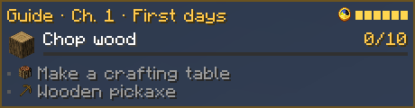
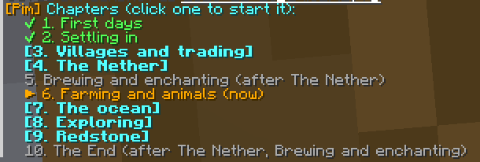

<!--
Project page for Modrinth and CurseForge (paste everything below the line).

Project settings
- Name: Survival Assistant          Slug: survival-assistant
- Summary: see docs/listing/summary.txt
- License: MIT
- Modrinth categories: adventure, game-mechanics, utility
- Modrinth environment: client required, server required (the guide and advice run on the server, the cards on the client)
- CurseForge categories: Adventure and RPG (main), Utility & QoL
- Links: source https://github.com/visserdavid/survival-assistant
         issues https://github.com/visserdavid/survival-assistant/issues
- Icon: docs/images/icon-512.png
- Gallery: see docs/listing/gallery.txt
-->

**Learn Minecraft survival while you play.** A friendly guide called Pim walks with you through **18 chapters**,
from your very first night to the ender dragon and beyond. He tells you what to do next, warns you when you're in
danger and celebrates every goal you reach.

## What you get
- **A guide who walks with you.** Tips at the right moment, praise for every goal, and he never gets in your way:
  no pushing, no blocking, no trampled farmland.
- **A task card** with your current goal, live counters (logs 6/10, blaze rods 2/3, ...) and a clock that counts
  down to sunset.
- **Safety warnings** for creepers, digging straight down, lava, the night, phantoms, ghasts, piglins without gold
  and, most urgent of all, the warden. One-time notes in special places: the Nether, temples, trial chambers,
  strongholds, the End, bastions, ancient cities and more.
- **A recipe card** next to your inventory for the item your task needs, and **crosshair info** for mobs and ores.
- **An environment card** with a pro and a con for every biome and the ores worth digging for at your height.
- **A light check** (key L) that shows every spot where monsters can spawn.
- **Your way back**: an arrow to your lost items after dying, and the way home at dusk.

## 18 chapters
| # | Chapter | Goals |
|---|---|---|
| 1 | First days | Wood, tools, a shelter, food, torches, iron, a shield |
| 2 | Settling in | A farm, full iron armor, a bow, diamonds, obsidian, an enchanting table |
| 3 | Villages and trading | Trade, emeralds, an enchanted book, an iron golem |
| 4 | The Nether | Golden armor, a fortress, blaze rods, Nether wart, back home safely |
| 5 | Brewing and enchanting | A brewing stand, a potion, 15 bookshelves, level 30, an anvil |
| 6 | Farming and animals | Tame an animal, milk, sugar cane, fishing, honey, your own horse |
| 7 | The ocean | A boat, a shipwreck, buried treasure, a turtle shell, a trident |
| 8 | Exploring | A map, a spyglass, a temple, the trial chambers, a vault |
| 9 | Redstone | An automatic door, a piston, a repeater, a hopper |
| 10 | The End | Eyes of ender, the stronghold, the ender dragon, an end city, an elytra |
| 11 | Netherite and bastions | Ancient debris, netherite gear, a respawn anchor |
| 12 | The Wither and the beacon | Summon and defeat the Wither, a full beacon |
| 13 | The Deep Dark | An ancient city, sneaking past sculk, a recovery compass |
| 14 | Raids and Illagers | A pillager outpost, the raid captain, win a raid, a totem of undying |
| 15 | Archaeology and trims | A brush, trail ruins, sherds, a decorated pot, an armor trim |
| 16 | Trial challenges | Breeze rods, wind charges, an ominous vault, the mace |
| 17 | The happy ghast | A dried ghast, a ghastling, a harness, flying together |
| 18 | Automation | An observer, an automatic furnace, a copper bulb, the crafter |

Chapters 1 and 2 are the base; after that you choose what to learn from a clickable menu in chat
(`/guide chapters`). Goals use Minecraft's own advancements where possible, so things you already did are ticked
off right away.

## Checked against the game
Every recipe, ore height, mob spawn and game fact the guide mentions was checked against Minecraft 26.3's own data
files. The research behind each chapter is on [GitHub](https://github.com/visserdavid/survival-assistant/tree/main/docs).
No speedrun tricks: the path is made for an average player.

## Meet Pim
The guide has a name and a story: an old explorer whose own first night went badly. Ask him about himself with
`/guide about`, give him another name with `/guide name`, or give him your own skin with `/guideskin`. Now and
then he shares a building idea for the biome you're in, or a remark about the animals around you.

## Optional: small talk with a local AI
If you like, the guide can chat with you through a language model that runs **on your own computer**
([llama.cpp](https://github.com/ggml-org/llama.cpp)). This is **off by default**. When you turn it on
(`/guide chat on`), the mod only connects to `llama-server` on your own machine (`127.0.0.1`); nothing is sent to
the internet. Without it, everything else works the same. Setup instructions and model advice are in the
[README](https://github.com/visserdavid/survival-assistant#small-talk-with-a-local-ai-model-optional).

## Languages
English, Dutch, German, French, Spanish, Italian, Portuguese (Brazil), Polish, Romanian, Russian, Ukrainian,
Mandarin Chinese (simplified), Arabic, Hindi and Indonesian. English and Dutch are the original texts; the other
languages are AI translations that use Minecraft's own names where possible. Corrections are very welcome on GitHub.

## Requirements
- Minecraft 26.3, Fabric Loader 0.20.1 or newer, [Fabric API](https://modrinth.com/mod/fabric-api), Java 25
- Install the mod on the server (or in singleplayer) and on the client.

Commands, configuration and everything else: see the [README on GitHub](https://github.com/visserdavid/survival-assistant).
Open source under the MIT license.
